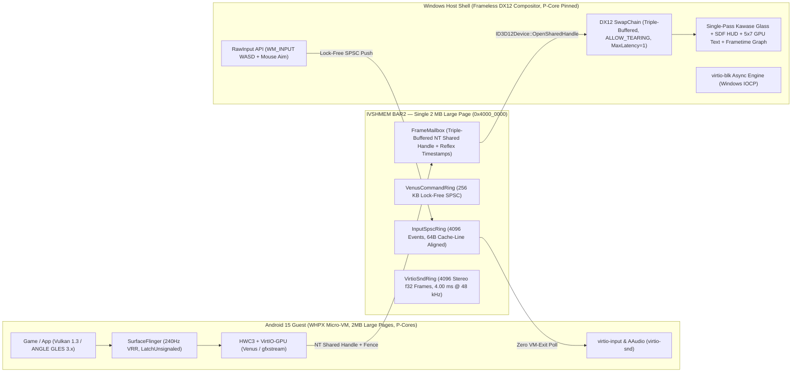

# Titan AOSP 15 (`API 35`) — Zero-Overhead PC Emulator Core

Экстремально лёгкий и высокопроизводительный прототип/ядро эмулятора **Android 15 (AOSP API 35)** для Windows PC, написанный на чистом Rust (`edition = 2021`) **без единой внешней зависимости** (`[dependencies]` пустой) с прямыми FFI/COM-биндингами к **DirectX 12**, **DXGI 1.5 (VRR / Allow Tearing)**, **Windows Hypervisor Platform (`WinHvPlatform.dll`)**, **2 MB Large Pages**, **Hybrid P-Core Pinning**, **RawInput API** и **IOCP**.

- **Размер релизного бинарника**: `406,528` байт (`~397 KiB`, `opt-level = 3`, `lto = "fat"`, `target-cpu = x86-64-v3`).
- **Сборка и тесты**: **0 внешних крейтов**, **12/12 unit/integration тестов** проходят на реальном оборудовании.

---

## Архитектура и Zero-Copy GPU Pipeline (Этапы 1–4)



---

## Этап 1: Карта памяти и Lock-Free IPC (`src/stage1_memory.rs`)

Весь lock-free обмен между гостевой ОС и хостом уложен в одну 2 МБ страницу (`IvshmemSharedRegion` = `364,544` байт <= `2,097,152` байт) с 64-байтным выравниванием атомарных счётчиков `head`/`tail` для исключения false sharing между физическими ядрами.

| Область / Структура | Guest Physical Address / Размер | Назначение |
|---|---|---|
| `GPA_VIRTIO_MMIO_BASE` | `0x0000_0000_3000_0000` | Дескрипторы VirtIO MMIO |
| `GPA_IVSHMEM_BAR2_BASE` | `0x0000_0000_4000_0000` (2 MB) | Единая страница управления и lock-free колец `IvshmemSharedRegion` |
| `GPA_LOW_RAM_BASE` | `0x0000_0000_8000_0000` | Основная RAM Android 15 на базе 2 MB Large Pages (`MEM_LARGE_PAGES`) |
| `FrameMailbox` | Triple-buffered `SharedFrameDescriptor` | `nt_shared_handle`, `acquire/release_fence_value`, `vrr_refresh_hz`, `reflex_*_us` |
| `InputSpscRing` | 4096 × 16 B (`VirtioInputEvent`) | Lock-free SPSC очередь для `RawInput -> virtio-input` |
| `VirtioSndRing` | 4096 × `[f32; 2]` (`4.00 ms` @ 48 kHz) | Аудиокольцо `AAudio -> virtio-snd -> WASAPI` |
| `VenusCommandRing` | 256 KB ring buffer | Поток Vulkan 1.3 команд `VirtIO-GPU (Venus / gfxstream)` + флаги pipeline cache |

---

## Этап 2: Native Frameless Window & DirectX 12 Compositor (`src/stage2_renderer.rs`, `src/win_dx12.rs`)

- **Frameless Win32 Shell (`WS_POPUP`)**: кастомный `WM_NCHITTEST` (рамка ресайза 6 px + верхняя панель перетаскивания 34 px + кнопки управления окном Minimize `-`, Maximize/Restore `+`, Close `X`), тёмная тема и скруглённые углы DWM (`DwmSetWindowAttribute`).
- **True Zero-Copy Texture Import**: `ID3D12Device::OpenSharedHandle` импортирует внешний `DXGI / VK_KHR_external_memory_win32` NT Handle напрямую в SRV-дескриптор без копирования на CPU.
- **VRR & QPC Frame Pacing**: `DXGI_SWAP_EFFECT_FLIP_DISCARD`, `DXGI_SWAP_CHAIN_FLAG_ALLOW_TEARING`, `DXGI_SWAP_CHAIN_FLAG_FRAME_LATENCY_WAITABLE_OBJECT`, `SetMaximumFrameLatency(1)` + точный QPC-ограничитель кадров под выбранную частоту `120 / 144 / 240 Hz`.
- **Interactive Android 15 GPU Canvas & Visualizers**: анимированный Material You фон 240 Hz в pixel shader (`PSGuest`), панель док-иконок и системная полоса жестов Android 15, живой визуализатор виртуального стика `WASD (MT Slot 0)` и прицела мыши `Aim (MT Slot 1)`.
- **Single-Pass Kawase Blur + SDF UI + 5x7 GPU Bitmap Font**:
  - 9-tap rotated Kawase frosted glass позади телеметрии HUD и выдвижной боковой панели.
  - Инстансинг UI-квадов напрямую в persistently mapped `UPLOAD` буфер (0 аллокаций на кадр).
  - Живой график frametime (64 столбца), средний FPS, **1% Low FPS**, Reflex latency, счётчики колец `InputSpscRing`/`VirtioSndRing`, объём памяти оболочки.
- **Дисковый кэш шейдеров (`pipeline_cache.bin`) & JSON-экспорт**: кэш DXBC с FNV-1a проверкой и выгрузка телеметрии в `titan_benchmark.json`.

### Горячие клавиши окна
- `F1` — показать / скрыть Telemetry HUD Overlay
- `F2` / `Tab` — свернуть / развернуть боковую панель Quick Actions
- `F3` — переключить целевой режим VRR (`120 Hz` / `144 Hz` / `240 Hz`)
- `F4` — переключить Smart Keymapper (`WASD + Mouse Aim` <-> `Raw Pointer`)
- `F5` — включить / отключить точный QPC Frame Pacer (под целевую частоту VRR)
- `F6` — экспортировать снимок бенчмарка в `titan_benchmark.json`
- `Esc` — выход

---

## Этап 3: WHPX Micro-VM, Large Pages, P-Core Pinning, RawInput & IOCP (`src/stage3_vm_input.rs`)

- **`LargePageArena`**: запрашивает `SeLockMemoryPrivilege` и выделяет 2 MB `MEM_LARGE_PAGES` (при отсутствии прав политики Windows использует гарантированно выровненный на 2 MB fallback).
- **`CpuPinningManager`**: через `GetSystemCpuSetInformation` отделяет Performance P-cores от Efficiency E-cores и привязывает поток рендера / vCPU строго к P-ядрам (`SetThreadSelectedCpuSets` + `SetThreadAffinityMask`).
- **`WhpxMicroVm`**: динамически загружает `WinHvPlatform.dll`, проверяет гипервизор, создаёт partition, мапит `GPA_LOW_RAM_BASE` и `GPA_IVSHMEM_BAR2_BASE`, создаёт vCPU.
- **`RawInputMapper`**: регистрирует `RAWINPUTDEVICE` для мыши и клавиатуры, переводит `WASD` в нормализованный вектор стика (`ABS_MT_SLOT 0`) и дельту мыши (`lLastX/lLastY`) в прицеливание (`ABS_MT_SLOT 1`) или аппаратный курсор (`EV_REL`), записывая события напрямую в `InputSpscRing`.
- **`VirtioBlkIocpEngine`**: асинхронный I/O через `CreateIoCompletionPort` + `OVERLAPPED` + `GetQueuedCompletionStatusEx`.

---

## Этап 4: AOSP 15 (`API 35`) Max-FPS Tuning (`aosp15-tuning/`, `src/stage4_aosp15.rs`)

- [`aosp15-tuning/0001-SurfaceFlinger-240Hz-VRR-ZeroCopy-VirtIO-GPU.patch`](aosp15-tuning/0001-SurfaceFlinger-240Hz-VRR-ZeroCopy-VirtIO-GPU.patch) — патч для `SurfaceFlinger` (`LatchUnsignaledConfig::Always`, минимальные фазовые оффсеты `0.5 ms / 0.75 ms`, отключение клиентского blur в пользу хостового Kawase-прохода).
- [`aosp15-tuning/BoardConfigTitan.mk`](aosp15-tuning/BoardConfigTitan.mk) — флаги `-O3 -march=x86-64-v3 -mavx2 -mfma`, `GLOBAL_THINLTO := true`, `BOARD_USE_PGO := true`, 2 MB HugePages в cmdline ядра.
- [`aosp15-tuning/titan_x86_64.mk`](aosp15-tuning/titan_x86_64.mk) — профили `ro.hardware.vulkan=venus`, `ro.hardware.egl=angle`, `aaudio.mmap_exclusive_policy=2`.
- [`aosp15-tuning/init.titan.rc`](aosp15-tuning/init.titan.rc) — отключение фоновых демонов (`ril-daemon`, `traced`, `statsd`, `logd`, `tombstoned`, `incidentd`, `update_engine`) и включение `performance` governor.

---

## Сборка и запуск

```powershell
# Запуск готового релизного .exe
.\titan-aosp15-emu.exe
.\titan-aosp15-emu.exe --self-test

# Запуск всех 12 модульных и интеграционных тестов
cargo test --release

# Сквозная самопроверка всех 4 этапов на реальном GPU / WHPX / IOCP (120 кадров)
cargo run --release -- --self-test

# Интерактивное нативное DirectX 12 окно (Frameless + Kawase HUD + Sidebar)
cargo run --release
```

### Зафиксированный вывод `--self-test` на текущей машине

```text
Stage 1 | IvshmemSharedRegion : 364544 bytes (<= 2097152 Large Page)
Stage 1 | SPSC Input Events   : 16 events queued lock-free (16 drained)
Stage 1 | Audio Ring Latency  : 4.00 ms (192 frames @ 48kHz, 1920 streamed)
Stage 2 | GPU Adapter         : Intel(R) UHD Graphics
Stage 2 | VRR Tearing Support : true
Stage 2 | External NT Import  : true (DXGI/Vulkan Zero-Copy)
Stage 2 | Shader Disk Cache   : HIT (pipeline_cache.bin)
Stage 2 | Benchmark JSON      : titan_benchmark.json (exported=true)
Stage 2 | 120-Frame Telemetry : Avg 883.5 FPS | 1% Low 547.7 FPS | Last 1.03 ms | Reflex 0.85 ms
Stage 2 | Shell RAM Footprint : WorkingSet 59.62 MiB (pre 58.02 MiB) | Private 72.01 MiB (pre 70.50 MiB)
Stage 3 | CPU Topology        : 8 P-cores, 4 E-cores (pinned=true)
Stage 3 | 2MB Large Pages     : false (2MB aligned=true)
Stage 3 | WHPX Micro-VM       : hypervisor_present=true, partition_ready=true, vcpus=8
Stage 3 | RawInput + IOCP Blk : rawinput_reg=true, iocp_xfer=4096 bytes
Stage 4 | AOSP API 35 Tuning  : x86-64-v3 (AVX2 + FMA + BMI2) | VirtIO-GPU Venus (Vulkan 1.3) + ANGLE (GLES 3.x) | LTO: ThinLTO + FatLTO (Host) | PGO: true
```
